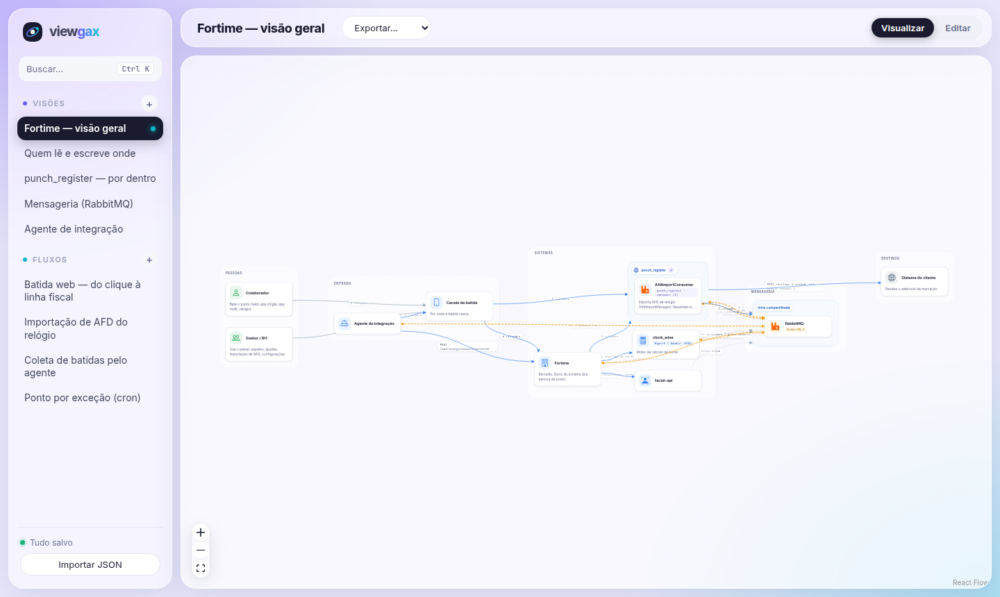
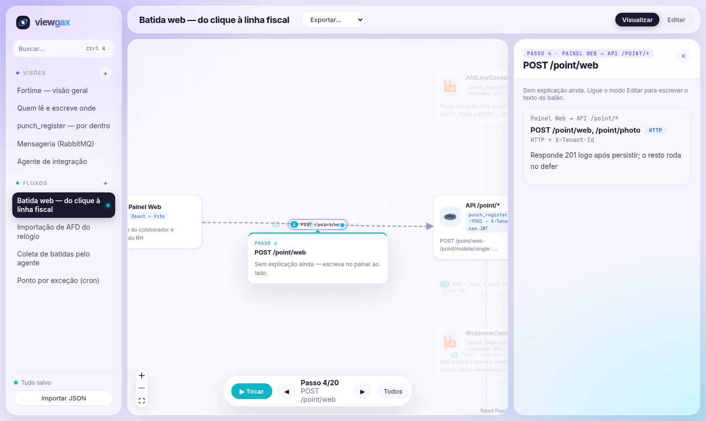

<p align="center">
  
</p>

<h1 align="center">viewgax</h1>

<p align="center">
  <strong>Como os sistemas conversam.</strong><br />
  Visões da arquitetura e fluxos passo a passo: quem chama quem, por qual protocolo, fila e payload.
</p>

<p align="center">
  
</p>

---

## O que tem

- **Visões**: cards aninhados (sistema → serviços), grupos em colunas e setas coloridas por tipo
  (`http`, `async`, `db`). Cada seta guarda protocolo, routing key, fila, ACK/DLQ e o payload formatado como JSON.
- **Fluxos**: passos numerados no mesmo canvas, com um balão explicando cada passo e um ponto
  percorrendo a seta ativa. ▶ **Tocar** avança sozinho.
- **Visão de detalhe**: duplo clique num card abre a visão que o detalha (ex.: `punch_register` → por dentro).
- **Busca** (`Ctrl+K`): card, fila, routing key ou visão; leva direto até ela.
- **Layouts automáticos**: Camadas →, Camadas ↓, Árvore, Radial e Grade. Depois é só arrastar.
- **Exportar** a visão inteira em PNG ou SVG.
- **Modo Visualizar / Editar** no topo: lendo, nada se move sem querer.

<p align="center">
  
</p>

## Rodando

```sh
docker compose up -d --build      # http://localhost:5173 (hot reload com o código do host)
docker compose up -d --build -V   # depois de mudar dependências (recria o node_modules do container)
npm test                          # ou: docker compose exec viewgax npm test
```

Sem Docker: `npm install && npm run dev`.

## Editando

Ligue **Editar** no canto superior direito.

| O quê | Como |
| --- | --- |
| Nova visão ou fluxo | `+` no menu lateral ou na tela inicial |
| Card | `+ Novo card` ou `+ Card existente`; clique nele para editar nome, tecnologia, ícone (com busca e prévia), cor, pai e grupo |
| Comunicação / passo | passe o mouse no card e arraste o ● até outro card |
| Grupo (coluna) | `+ Grupo`; clique no grupo para renomear e mudar a ordem |
| Visão de detalhe | no painel do card, "Visão de detalhe" → escolha uma ou crie uma nova |
| Explicação do passo | painel do passo → "Explicação (balão)" |

### Atalhos

| Tecla | Faz |
| --- | --- |
| `Ctrl+K` | buscar |
| `Ctrl+Z` / `Ctrl+Shift+Z` | desfazer / refazer |
| `Delete` | tira o card da visão (continua no modelo) ou apaga o grupo |
| `Ctrl+C` / `Ctrl+V` | duplica o card, também entre visões |
| `←` `→` / `espaço` | passo anterior / próximo / tocar o fluxo |

## Onde fica salvo

Cada edição é salva sozinha (indicador na barra lateral) em `DATA_FILE`, que no container é
`/app/storage/fortime.json` no volume `viewgax-data`. Para ter o JSON numa pasta do host, troque o volume no
`compose.yml` por `./storage:/app/storage`.

- Na primeira execução o arquivo nasce de `data/fortime.json` (semente versionada).
- **Importar JSON** substitui tudo pelo arquivo escolhido.
- Se outra pessoa salvar antes de você, o app para de salvar e pede para recarregar, sem sobrescrever o
  trabalho dela.
- `npm run build` gera um site estático somente leitura (mostra a semente).

## Stack

Vite · React · TypeScript · [@xyflow/react](https://reactflow.dev) · [elkjs](https://github.com/kieler/elkjs)
(layouts) · [@likec4/icons](https://likec4.dev) · html-to-image
